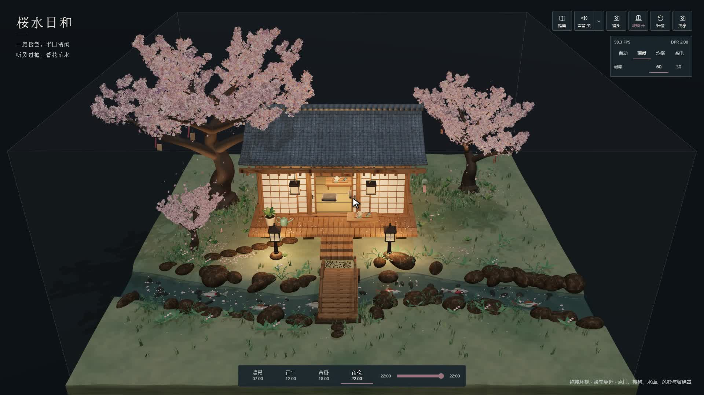
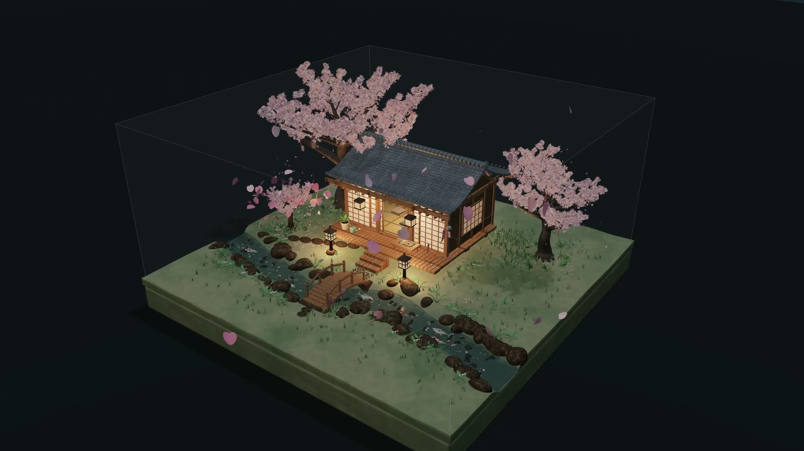

# 桜水日和（Sakura Hiyori）

一座会落樱的日式水岸小屋 —— three.js 实时 3D 场景。

## 这是什么

微缩庭院模型：樱花树、木屋、溪流与锦鲤、石灯笼、风铃、纸拉门。
可自由环视，内置六个机位、四个时段，并支持点击交互（樱树花瓣雨、开关门与入室、水面涟漪、风铃、玻璃罩）。

## 运行

浏览器不能直接通过 file:// 读取 GLB，需要在 web/ 目录下起一个本地服务器：

~~~bash
cd web
python -m http.server 8080
~~~

然后打开 http://localhost:8080/

依赖：

- three.js 0.169（通过 jsDelivr CDN 加载）
- Draco 解码器（通过 CDN 加载）
- 首次打开需要联网；模型文件在仓库内（Git LFS）

## 操作

| 操作 | 效果 |
|---|---|
| 拖拽 | 环视庭院 |
| 滚轮 | 推近/拉远 |
| 右键拖拽 | 平移 |
| 镜头按钮 | 六个手动机位（庭院主视角、溪石听水、花下观树、檐影闻铃、穿桥见院、茶室入口） |
| 底部时段 | 清晨 07:00 / 正午 12:00 / 黄昏 18:00 / 夜晚 22:00 |
| 点击樱树 | 花瓣雨（大/中/小三棵，数量不同） |
| 点击门 | 开合、入室 |
| 点击水面 | 涟漪 |
| 点击风铃 / 玻璃罩 | 声音、玻璃罩开关 |
| 纯享 | 隐藏全部界面 |

## 目录

~~~
web/
  index.html                  场景页面（含界面与交互）
  sakura_source_r5_bundle.js  three.js 场景与资产构建
  sakura_source_r5_entry.js   交互、镜头、时段逻辑
  assets/
    桜日和_网页资产_r5.glb     3D 模型（167 MB，Git LFS）
screenshots/                  截图
docs/                         阶段验收报告与场景回顾
~~~

## 资产与 Git LFS

模型文件 167 MB，使用 Git LFS 存储。克隆前先安装：

~~~bash
git lfs install
git clone https://github.com/dafeiyu201008/sakura-hiyori.git
~~~

## 制作与版权

- 场景制作：**Kimi**
- 仓库整理与发布：大肥鱼
- 版权归作者所有；仓库未声明开源许可，未经许可请勿商用或二次分发。
- 229 MB 的「离线单文件版」未入库（体积过大），需要时另行提供。
