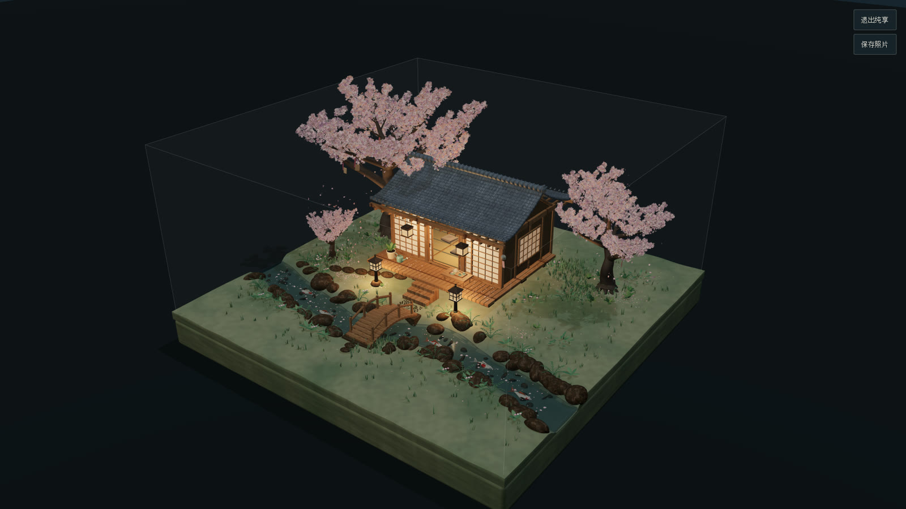

# 桜水日和 · Sakura Hiyori

> 一座会落樱的日式水岸小屋 —— three.js 实时 3D 微缩庭园  
> A living Japanese riverside garden, built with three.js.

## 在线体验

- 在线试玩：https://dafeiyu201008.github.io/sakura-hiyori/
- 演示视频：[demo/sakura-demo-30s.mp4](demo/sakura-demo-30s.mp4)（30 秒 / 1080p / 无音轨）

## 特性

| 能力 | 说明 |
|---|---|
| 六个机位 | 庭院主视角、溪石听水、花下观树、檐影闻铃、穿桥见院、茶室入口 |
| 四个时段 | 清晨 07:00 / 正午 12:00 / 黄昏 18:00 / 夜晚 22:00，平滑过渡，另有连续滑杆 |
| 点击交互 | 三棵樱树花瓣雨（260 / 160 / 90 片）、门扇开合与入室、水面涟漪、风铃、玻璃罩 |
| 声音 | 总音量控制，风、水、铃三路音源，一键开关 |
| 画面 | 画质四档（自动 / 画质 / 均衡 / 省电）、60 或 30 帧、纯享模式、纯享保存照片 |
| 适配 | 桌面与移动端布局，支持 prefers-reduced-motion |

## 快速开始

模型约 31 MB（网页优化版：Draco 压缩 + WebP 2K 贴图），直接克隆即可：

~~~bash
git clone https://github.com/dafeiyu201008/sakura-hiyori.git
cd sakura-hiyori/web
python -m http.server 8080
~~~

打开 http://localhost:8080/

依赖说明：

- three.js 0.169 与 Draco 解码器通过 jsDelivr CDN 加载，首次打开需要联网；
- 模型文件在仓库内（约 31 MB），无需 Git LFS；
- 仓库内是网页优化版；167 MB 原始模型可另行提供；
- 浏览器不允许 file:// 直接加载 GLB，必须起本地服务器。

## 操作

| 操作 | 效果 |
|---|---|
| 拖拽 | 环视庭院 |
| 滚轮 | 推近 / 拉远 |
| 右键拖拽 | 平移 |
| 镜头按钮 | 切换六个手动机位 |
| 底部时段 | 切换四个时段，拖动滑杆可连续调时 |
| 点击樱树 | 花瓣雨（大 / 中 / 小三棵，数量不同） |
| 点击门 | 开合、入室 |
| 点击水面 | 涟漪 |
| 点击风铃 / 玻璃罩 | 声音、玻璃罩开关 |
| 纯享 | 隐藏全部界面 |

## 技术架构

- **渲染**：three.js 0.169 + WebGL2，GLTFLoader 加载 GLB，DRACOLoader 解压；
- **场景构建**：bundle 程序化生成庭园、木屋、溪流、植被与粒子，模型资产单独存放；
- **时段系统**：关键帧插值驱动背景、半球光、主光、轮廓光、室内光、材质自发光与曝光；
- **交互**：Raycaster 命中樱树、门、水面、风铃与玻璃罩，触发粒子、动画与提示；
- **镜头**：六个预设机位 + 缓动补间；入室后切换为受限环视，退出时恢复；
- **性能**：按设备选择 DPR 与帧率，提供四档画质，移动端单独布局。

## 项目结构

~~~
web/
  index.html                  场景页面（界面与交互）
  sakura_source_r5_bundle.js  场景与资产构建
  sakura_source_r5_entry.js   交互、镜头、时段逻辑
  assets/
    桜日和_网页资产_r5.glb     3D 模型（Draco + WebP 2K，约 31 MB）
screenshots/                  四时段、镜头面板、花瓣与茶室截图
demo/                         30 秒演示视频与封面
docs/                         设计说明、版本记录、性能数据
~~~

## 版本演进

| 版本 | 关键进展 |
|---|---|
| r1 – r3 | 场景骨架、材质与光照第一版 |
| r4 | 4K 贴图与网页资产优化 |
| r5 | 模块化拆包、性能分级、移动端适配 |
| 7.3 – 7.5 | 屋顶、檐廊、风铃、茶室与交互完善 |
| 7.6 | 真实录音音频引擎、UI 定稿、验收通过 |

详细记录见 [docs/CHANGELOG.md](docs/CHANGELOG.md)。

## 性能

在 1920×1080、画质档、DPR 2.0 下实测 60 FPS（详见 [docs/PERFORMANCE.md](docs/PERFORMANCE.md)）。

## 致谢与版权

- 场景制作：**Kimi**
- 仓库整理、录制与发布：大肥鱼
- 第三方库：three.js（MIT）、DRACO（Apache-2.0）
- 音频素材来源：待补充

## License

- **代码**：MIT，见 [LICENSE](LICENSE)
- **美术资产**（GLB、贴图、截图、演示视频）：CC BY-NC 4.0，见 [LICENSE-ASSETS](LICENSE-ASSETS)

商用或二次分发前请先联系作者。
